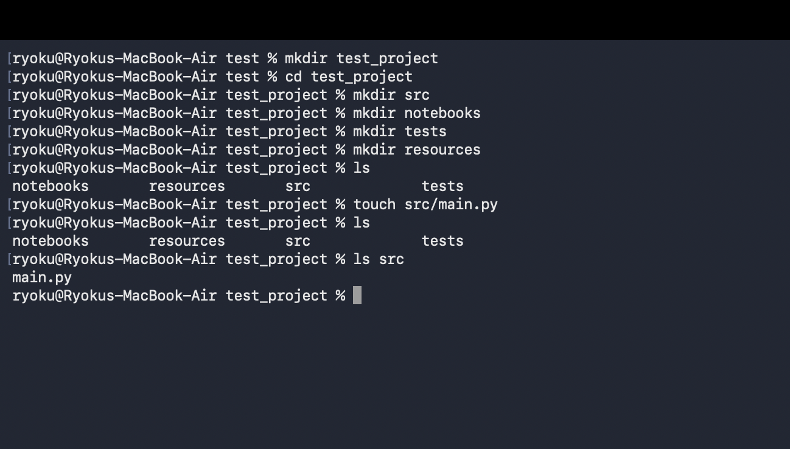
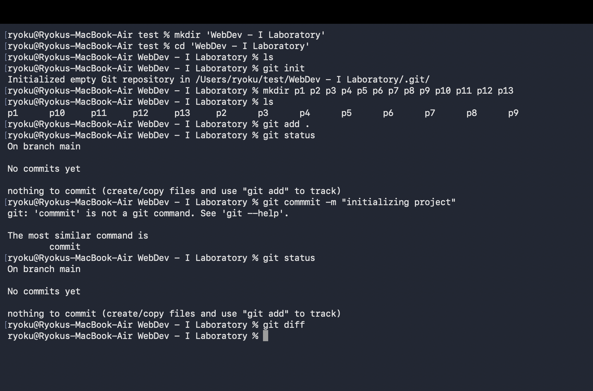
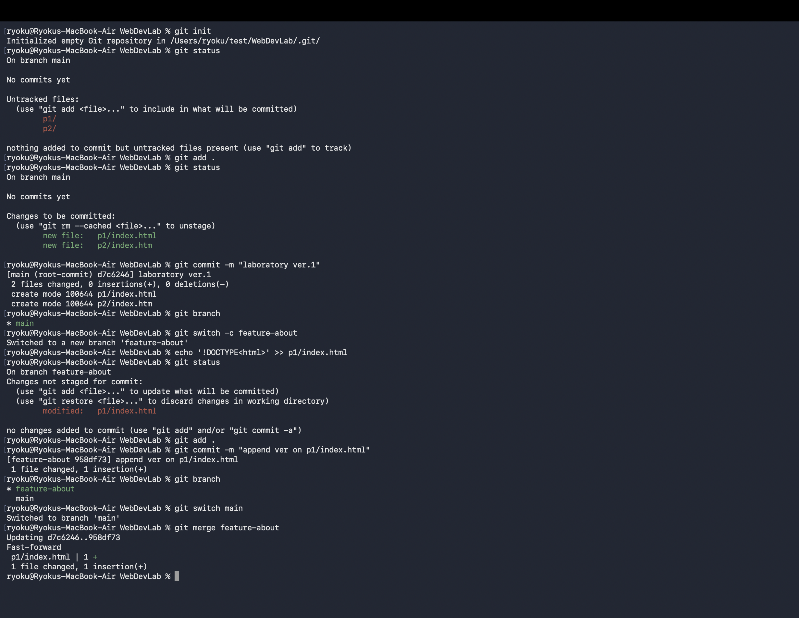
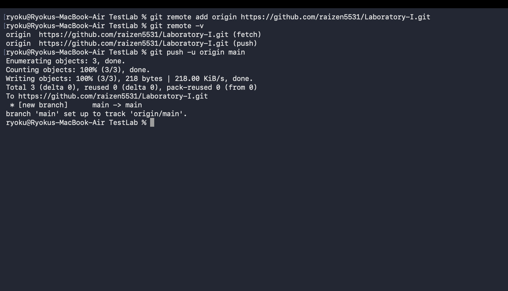
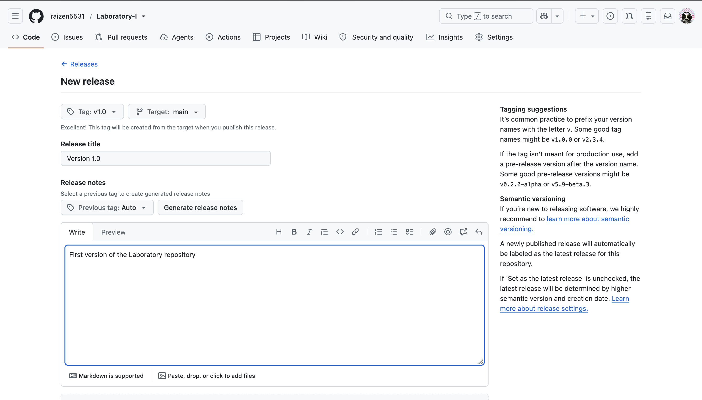
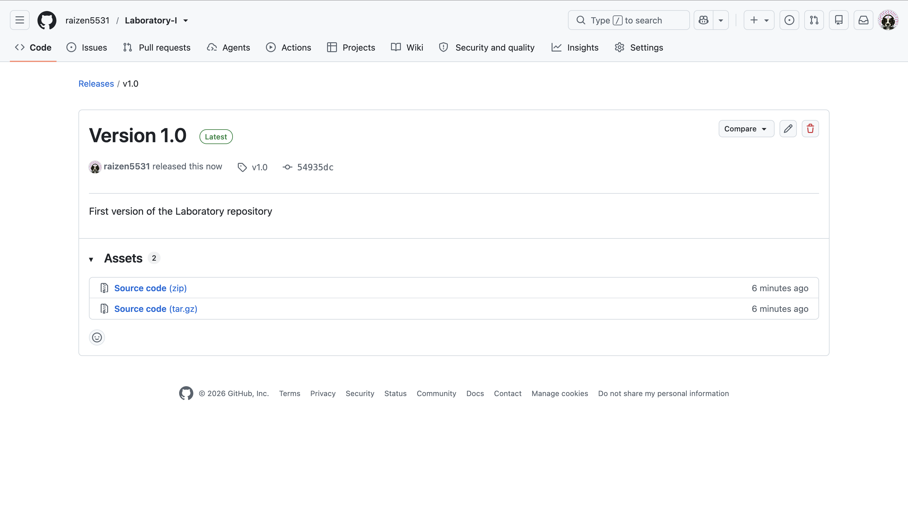

# Laboratory - I

## Description
Repository for Web Development Laboratory 1.
The repository contains exercises P1 to P13.

## Technologies Used -
- HTML
- CSS
- Git
- Github
---

## P1

## P2

## P3

## P4 - divided into a, b, c

### P4 - A

Attaching local git to the remote repository.

### P4 - B

Creating version tag using Github.

### P4 - C

Version tag created successfully.

## Author
Aatman Shanker
